# R-hive Construction Roofing Specialist: Master Customer Telephony Flowchart & Script Matrix (Revision 67)
**System Target Line:** +1 (839) 867-6637 (`839-86-ROOFS`) *(All calls to RHIVE Main are forwarded here via JustCall for Honey to answer directly)*  
**Engine:** Google Gemini 3.8 Live Multimodal Speech-to-Speech (`gemini-3.8-live` & `gemini-3.8-live-extended-thinking`)  
**Acoustic Profile:** Leda (Honey AI Roofing Specialist & Executive Project Specialist) | **Tone:** High warmth, radiant vocal smile  
**Architecture:** Zero-IVR Ring 1 Direct Answer (Pure Voice, Zero Robotic Menus)  

---

## 1. High-Resolution Zoomable Customer Decision Architecture

> [!TIP]
> **Vector Crisp Zooming:** Below is the comprehensive end-to-end flowchart. You can zoom in up to 500% in your browser or viewer without loss of fidelity.

```mermaid
flowchart TD
    Dial["Caller Dials Office Line / Forwarded from RHIVE Main via JustCall"] --> Ring1["Honey Ring-1 Direct Answer (Zero IVR Menus / Pure Voice)<br/>150ms Settle Delay + Radiant Vocal Smile<br/>'Hi! This is Honey! R-hive's AI Roofing Specialist, how may I assist your call today?'"]

    %% Direct Address & Intent Flow
    Ring1 --> AddrCapture1["Customer States Reason & Property Address"]
    AddrCapture1 --> ToolProp1["TOOL: verify_address<br/>OpenStreetMap Geocoding + Utah County Parcel ($0.00) + Open-Meteo County Weather"]
    
    ToolProp1 --> AddrConfirm{"Mandatory Audio Verification Gate:<br/>Honey reads back: 'I have [Address], [City], Utah [Zip]—does that match your property?'<br/>Honey PAUSES & WAITS for verbal confirmation"}
    
    AddrConfirm -->|No / Corrected| FixAddr["Caller Corrects Number or Street -> Re-run verify_address"]
    FixAddr --> ToolProp1
    AddrConfirm -->|Yes / Confirmed| PropNameUpdate["Derive & Adopt propertyName:<br/>e.g., 'the 9917 South property' or 'the 10437 Shady Plum property'<br/>Honey: 'I have your property details pulled up right here on our cloud server.'"]

    %% Intent Qualification with Shorthand
    PropNameUpdate --> Q_Intent{"Honey Qualifies Intent (Adopting Shorthand):<br/>'Perfect! For the [propertyName], are you looking for a certified quote on an aging roof,<br/>is this for storm damage, leaks, and emergency tarping, or commercial and multi-property projects?'"}

    %% Case 1: Residential Replacement (Core Business Model - Remote Aerial + 15-Min Video Option)
    Q_Intent -->|Case 1: New Customers & Certified Quotes| RemoteAerial["Core Model: Remote Aerial Measurement & 15-Min Video Call<br/>Honey: 'We measure your roof via precision aerial engineering to deliver<br/>a certified quote without interrupting your day with a truck roll.'"]
    RemoteAerial --> WeatherUrgency1["County & City Weather Urgency:<br/>'Looking at [County] weather, with upcoming [precipitation/wind]% forecast for [City],<br/>locking in your scope early ensures you beat the seasonal schedule surge.'"]
    WeatherUrgency1 --> VideoCallOption{"Visible from Ground?<br/>Offer 15-Minute Remote Phone Video Call"}
    VideoCallOption -->|Homeowner Walks Outside| VideoSlot["Schedule 15-Minute Remote Video Call Inspection<br/>Specialist inspects live from ground via smartphone video"]
    VideoCallOption -->|Aerial Scan Preferred| MeasureCall["MeasureCall Ping-Pong Sequence (1 Question / Turn):<br/>1. Structural additions & Solar detach warranty?<br/>2. Skylights, swamp coolers & satellite removals?<br/>3. Layer count (slope-aware)?<br/>4. Ventilation & Slat Decking Check (unforeseen expense, terms in agreement)?<br/>5. Gutters (Simple 'suit to body' metaphor: front, back, all-around)?<br/>6. Winter ice dams & heat trace hotspots?<br/>7. Shingle Hierarchy: Contractor -> Duration baseline -> Flex -> Designer?<br/>8. Simplified DISC psychometrics & timeline (<20 words)?"]
    VideoSlot --> CloseProtocol
    MeasureCall --> CloseProtocol

    %% Case 2: Commercial & Multi-Property Management
    Q_Intent -->|Case 2: Commercial & Multi-Property Projects| CommercialPath["Commercial roofs & multi-property portfolios require on-site evaluations for core cuts & parapets<br/>TOOL: get_available_windows (Michael & Kara Calendar)"]
    CommercialPath --> WeatherUrgency2["Commercial Weather Check:<br/>Evaluate precipitation forecast for flat roof drainage & ponding risks"]
    WeatherUrgency2 --> PresentSlots

    %% Case 3: Storm Damage, Leaks & Emergency Tarping
    Q_Intent -->|Case 3: Storm Damage, Leaks & Emergency Tarping| LeakCheck{"Active Leak / Dripping Inside Now?"}
    LeakCheck -->|Yes| ActiveTarp["Emergency Leak Tarping ($150 Mobilization Fee Credited to Scope)<br/>Covers all leaks from a single weather event unless catastrophic multi-plane/steep rigging.<br/>Honey checks County & City Weather Urgency:<br/>'It looks like there is an [X]% chance of rain in [County] moving into [City]...'"]
    ActiveTarp --> CloseProtocol

    LeakCheck -->|No / Storm Insurance Claim| InsurancePath["Forensic storm damage scope documentation for adjuster (UPPA Compliant)<br/>TOOL: get_available_windows"]
    InsurancePath --> PresentSlots

    %% Case 4: Roof Repairs (Partial Replacements vs Clear Photos vs On-Site)
    Q_Intent -->|Case 4: Roof Repairs| RepairAge{"Is roof older or younger than 15 years?"}
    RepairAge -->|Older than 15 Years| OlderRoof["Brittle Shingles: Plasticizers evaporate after 15-20 yrs in Utah.<br/>Prying shingles cracks adjacent courses. Specialist evaluates if repair holds<br/>or if south/west facet partial replacement is needed.<br/>TOOL: get_available_windows"]
    OlderRoof --> PresentSlots
    RepairAge -->|Younger than 15 Years| RepairTriage{"Has visible exterior photos?"}
    RepairTriage -->|Exterior Photos| SendPhotoSMS["Text clear exterior roof photos back to specialist<br/>Reviewed within 24 hours"]
    SendPhotoSMS --> CloseProtocol
    RepairAge -->|No Photos / Cannot Access| VideoOrOnSite["Offer 15-Minute Remote Video Call from Ground<br/>or On-Site Inspection Window"]
    VideoOrOnSite --> PresentSlots

    %% Calendar Booking Branch
    PresentSlots["Honey Presents Tight 3-Hour Arrival Cushion"]
    PresentSlots --> SlotConfirm["Customer Confirms Arrival Window"]
    SlotConfirm --> BookCal["TOOL: book_inspection<br/>Inserts into 'RHIVE Project Inspections' Google Calendar<br/>SMS to Michael, Kara & Customer | Chat Webhook"]
    BookCal --> CloseProtocol

    %% Branch: Operations, Trade Suppliers & Permitting (Flow 3)
    Ring1 -->|Trade Partner / Supplier / Inspector| TradePath["Trade / Supplier / Inspector Identification<br/>Recognizes Quality B Roofing as premier subcontractor partner.<br/>TOOL: transfer_to_specialist (target: kara, 25s timeout)"]
    TradePath --> KaraWhisper["Kara Warm Whisper Handoff (+150ms settle pause)"]

    %% Branch: Cold Solicitors & Spammers (Flow 4)
    Ring1 -->|Cold Pitch / Marketing / Spammer| SpamPath["Anti-Spam Quarantine Policy Triggered<br/>Global Schedule Confidentiality (never disclose calendars/locations).<br/>Redirect to info@rhiveconstruction.com (Zero Upward Transfer)"]
    SpamPath --> GracefulDrop["Event-Driven Speech Buffer Disconnect<br/>Wait turnComplete + 1500ms audio drain -> terminate carrier cleanly<br/>(Abort if caller speaks during buffer)"]

    %% Mandatory 4-Step Close Sequence
    CloseProtocol["Mandatory 4-Step Closing Sequence:<br/>Recap -> text to cell ending in [last 4] -> secondary check -> 'Goodbye!' -> 1500ms drain"]
    CloseProtocol --> Step1["Step 1: Express Authentic Gratitude (with Vocal Smile)"]
    Step1 --> Step2["Step 2: Communication Channel & Contact Confirmation<br/>'We will reach out to the number ending in [last 4 digits]'"]
    Step2 --> Step3["Step 3: Secondary Check: 'Is there anything else I can assist you with today?'"]
    Step3 --> Step4["Step 4: Graceful Voice Disconnect (1500ms Audio Buffer Flush)"]
```

---

## 2. Dynamic Turn-by-Turn Conversational Script Matrix

| Turn | Intent / Trigger | Honey Spoken Output (Strict Acoustic Standard) | Backend State & Tool Execution |
| :--- | :--- | :--- | :--- |
| **0** | Inbound Call Connect | *(Carrier settle 150ms)* `"Hi! This is Honey! R-hive's AI Roofing Specialist, how may I assist your call today?"` | CallSession initialized; ambient audio loaded; JustCall CDR synced. |
| **1** | Address Stated | `verify_address` geocodes address; Honey reads back: `"I have [Address], [City], Utah [Zip]—does that match your property?"` | `verify_address` called; Google Solar pitch matrix & parcel data queried. |
| **2** | Audio Confirmation | Caller confirms; Honey derives shorthand: `"Perfect! For the [propertyName], are you looking for a certified quote on an aging roof..."` | `addressConfirmed = true`; `propertyName` adopted. |
| **3** | Core Intake (Ping-Pong) | Honey asks **strictly 1 question per turn** (<25 words): - Solar panels & structural additions - Skylights, coolers & satellite dishes - Slope-aware layer count - Eave intake vents & pre-1972 slat deck unforeseen expense - Gutters ("suit to body" metaphor) - Heat trace ice dam problem areas - 4-Tier Shingle Hierarchy (Duration baseline standard) - Simplified DISC: *"When it comes to your new roof, what matters most to you: getting on the schedule quickly, keeping costs down, or maximum warranty protection?"* | Session fields updated; Google Solar CAD geometry stamped. |
| **4** | On-Site Exception | If one of the 5 exceptions applies: Honey queries `get_available_windows` and offers top 2 arrival windows: *"I have an arrival window open tomorrow between 9 AM and 12 noon, or tomorrow afternoon between 1 PM and 4 PM..."* | `get_available_windows` -> `book_inspection` executed on calendar. |
| **5** | Closing Protocol | 1. Gratitude: `"Awesome, [Name]! We have everything we need..."` 2. Recap: Name & email phonetic spelling. 3. Channel: `"Texting proposal to the number ending in [last 4]..."` 4. Secondary check: `"Is there anything else I can assist you with today?"` 5. Farewell: `"You are so welcome! Have a wonderful day! Goodbye!"` | `hangup_call` armed; 1500ms buffer drain executed; abort if caller speaks. |

---

## 3. Master Telephony Swarm Cross-Flow Artifact Links

| Swarm Node | Scope & Function | Document Link |
| :--- | :--- | :--- |
| **Flow 1** | Residential & Commercial Certified Quotes, Repairs & Maintenance | [flow_quotes_residential_commercial.md](file:///c:/Users/mjrob/OneDrive/Desktop/App%20Repo%20s/RHIVE-Construction/RHIVE-Telephony/docs/flow_quotes_residential_commercial.md) |
| **Flow 2** | Emergency Active Leak Tarping ($150+ Credited) & Insurance Restoration | [flow_emergency_leaks_insurance_storm.md](file:///c:/Users/mjrob/OneDrive/Desktop/App%20Repo%20s/RHIVE-Construction/RHIVE-Telephony/docs/flow_emergency_leaks_insurance_storm.md) |
| **Flow 3** | Trade Partners, Material Suppliers, Municipal Permitting & Compliance | [flow_trade_suppliers_permitting_compliance.md](file:///c:/Users/mjrob/OneDrive/Desktop/App%20Repo%20s/RHIVE-Construction/RHIVE-Telephony/docs/flow_trade_suppliers_permitting_compliance.md) |
| **Flow 4** | Cold Solicitor & Unsolicited Marketing Anti-Spam Perimeter Quarantine | [flow_anti_spam_quarantine.md](file:///c:/Users/mjrob/OneDrive/Desktop/App%20Repo%20s/RHIVE-Construction/RHIVE-Telephony/docs/flow_anti_spam_quarantine.md) |
| **Master Spec** | Complete Master Telephony System Specifications & Swarm Architecture | [master_telephony_workflow_specification.md](file:///c:/Users/mjrob/OneDrive/Desktop/App%20Repo%20s/RHIVE-Construction/RHIVE-Telephony/docs/master_telephony_workflow_specification.md) |
| **Flowchart** | Visual End-to-End Decision Flowchart & Script Matrix | [customer_telephony_flowchart.md](file:///c:/Users/mjrob/OneDrive/Desktop/App%20Repo%20s/RHIVE-Construction/RHIVE-Telephony/docs/customer_telephony_flowchart.md) |
| **Live Bridge** | Production GCP Cloud Run Speech-to-Speech WebSocket Implementation | [server.js](file:///c:/Users/mjrob/OneDrive/Desktop/App%20Repo%20s/RHIVE-Construction/RHIVE-Telephony/server.js) |
