# Flow 1: Residential & Commercial Quotes, Repairs, Replacements & Maintenance
**Swarm Revision:** Revision 67 Master Alignment  
**Target Environment:** Google Cloud Run (`rhive-voice-live-bridge`)  
**Telephony Engine:** Google Gemini 3.8 Live Multimodal Speech-to-Speech (`gemini-3.8-live` & `gemini-3.8-live-extended-thinking`)  
**System Target Line:** +1 (839) 867-6637 (`839-86-ROOFS`) *(All calls to RHIVE Main are forwarded here via JustCall for Honey to answer directly)*  
**Lead Architect:** Michael Robinson (RHIVE Construction)  
**Primary Canonical Document:** `flow_quotes_residential_commercial.md`

---

## 1. Executive Summary & Flow Topology

Flow 1 governs all residential and commercial roofing inquiries spanning full replacements, partial replacements, repairs, ongoing service agreements, and routine maintenance visits along the Wasatch Front. 

The core operational thesis of RHIVE is **remote aerial engineering precision**: a Certified Quote has a dedicated Project Specialist pull high-resolution satellite CAD scans (via Google Solar, precision Roofr, or satellite engineering), county parcel tax rolls, municipal permit history, and manufacturer codes to calculate the exact engineering proposal. **We do not need to be at the address to build a certified quote.** For residential roofs visible from the ground and minor repairs, Honey offers a **15-Minute Remote Phone Video Call Inspection** conducted via **Google Meet / Google Calendar**, eliminating unnecessary truck rolls entirely. An in-person on-site roof inspection is strictly reserved for 5 explicit exceptions.

> [!NOTE]
> **JustCall Inbound Call Forwarding Architecture:**
> Incoming calls placed to the primary RHIVE Main office telephone numbers are dynamically forwarded to `+1 (839) 867-6637` (`839-86-ROOFS`) within the **JustCall** carrier PBX routing table. This allows Honey to answer 100% of inbound calls directly on Ring 1 with zero IVR menus, while preserving JustCall's historical call records and outbound caller ID reputation.

```mermaid
flowchart TD
    A["Inbound Call / Forwarded from RHIVE Main via JustCall"] --> B["Honey Ring 1 Answer (Zero IVR Menus / Pure Voice)<br/>150ms Settle Delay + Radiant Vocal Smile<br/>'Hi! This is Honey! R-hive's AI Roofing Specialist, how may I assist your call today?'"]
    
    B --> NameCapture["Caller States Name"]
    NameCapture --> NameVerify["First Name Spelling Verification Gate:<br/>Honey: 'Hi Sarah! Is that spelled S-A-R-A-H?'<br/>Honey PAUSES & WAITS for verbal confirmation right there"]
    
    NameVerify --> F["Turn 2: Capture Property Address<br/>Data Field: propertyAddress"]
    F --> G["OpenStreetMap Geocoding & Utah County Parcel Query<br/>TOOL: verify_address"]
    G --> H{Address Valid & Wasatch Front?}
    H -- No / Misheard --> I["Address Reloop: Phonetic & Number Confirmation"]
    I --> G
    H -- Out of Service Area --> J["Polite Out-of-Area Referral & Clean Disconnect"]
    H -- Yes --> H1["Turn 3: Mandatory Audio Verification Gate<br/>'I have [Address], [City], Utah [Zip]—does that match your property?'<br/>Honey PAUSES & WAITS for verbal confirmation"]
    H1 --> H2{"Caller Confirms Audio Accuracy?"}
    H2 -- No / Correction --> I
    H2 -- Yes --> H3["Derive propertyName Shorthand:<br/>'the 9917 South property'<br/>Honey: 'I have your property details pulled up right here on our cloud server.'<br/>Data Field: propertyName"]
    H3 --> K["Trigger Google Solar CAD & County Tax Roll Query<br/>Data Field: parcelId, yearBuilt, decadeBuilt"]
    K --> L["Calculate 3D Surface Area, Facet Aggregation & Pitch Multipliers<br/>Data Field: roofSquares, facetCount, pitchMatrix, googleSolarMeasurements"]
    L --> M{"Intent Triage Gate:<br/>'For the [propertyName], are you looking for a certified quote on an aging roof...'"}
    
    M -- Ballpark / Budget Planning --> N["Instant Ballpark Estimator vs Certified Quote Choice<br/>Data Field: quoteTier"]
    N --> O{Wants Certified Quote?}
    O -- Yes --> P["Advance to Remote Aerial CAD / MeasureCall Ping-Pong"]
    O -- No --> Q["Educate on Instant Estimator & Text Link to Cell ending in [last 4]"]

    %% The 5 Explicit On-Site Inspection Exceptions
    M -- Commercial Roofing --> R["Schedule On-Site Commercial Roof Inspection: 60/80 TPO/PVC<br/>TOOLS: get_available_windows + book_inspection"]
    M -- Active Leak Tarping --> S["Schedule Emergency Tarp: In our experience, insurance covers emergency mitigation;<br/>otherwise $150 mobilization fee 100% credited to repair"]
    M -- Repair >15yo Roof (Embrittlement) --> T["Schedule On-Site Damage Inspection: Embrittlement Check<br/>Plasticizers evaporated; evaluate spot repair vs south/west partial replacement<br/>TOOLS: get_available_windows + book_inspection"]
    M -- Insurance Storm Claim (UPPA) --> T_UPPA["Schedule On-Site Forensic Storm Damage Scope Inspection<br/>TOOLS: get_available_windows + book_inspection"]
    M -- Homeowner Explicitly Requests On-Site --> T_Req["Schedule On-Site Roof Inspection<br/>TOOLS: get_available_windows + book_inspection"]
    
    %% Repair & Replacement Ground Visibility Triage
    M -- Standard Residential Replacement / Repair --> V_Option{"Visible from Ground?<br/>Offer 15-Minute Remote Video Call via Google Meet"}
    V_Option -- Yes / Ground Visible --> V_Video["Schedule 15-Minute Video Call Inspection via Google Meet / Calendar<br/>Specialist inspects live via homeowner smartphone stream"]
    V_Option -- No / Aerial Only --> P
    
    M -- Specialty Material --> V0["Consultative Specialty Partner Referral: Metal/Tile/Slate/Euroshield<br/>Managed under RHIVE Prime Contractor Warranty"]

    subgraph MeasureCall ["MeasureCall Ping-Pong Sequence (1 Question / Turn)"]
        P --> V1["Q1: Structural Additions, Solar Panels & Detach Warranty<br/>Data Field: solarStatus, solarDetachParty"]
        V1 --> V2["Q2: Skylights, Swamp Coolers & Satellite Removals<br/>Data Field: skylights_count, swamp_cooler_removal, satellite_removal"]
        V2 --> V3{"Slope Check: Flat vs Pitched?"}
        V3 -- Pitch <= 2/12 --> V3A["Q3A: Flat Membrane Layers: 1, 2, 3+ (TPO/PVC)<br/>Data Field: membraneLayers"]
        V3 -- Pitch >= 3/12 --> V3B["Q3B: Shingle Layers: 1, 2, 3+ & Tear-off Weight Load<br/>Data Field: shingleLayers"]
        V3A --> V4
        V3B --> V4
        V4["Q4: Eave Ventilation & Slat Board Decking Custom Talking Point (Pre-1972 Era)<br/>Unforeseen expense in written agreement; never spoken dollar price<br/>Data Field: deckingType, eaveIntake, slatDeckRisk"]
        V4 --> V5["Q5: Gutters: Front, Back, All-Around (Simple 'Suit to Body' Metaphor)<br/>Data Field: gutterScope, gutterLocations"]
        V5 --> V6["Q6: Winter Ice Dams & Heat Trace Problem Areas<br/>Data Field: heatTraceAreas"]
        V6 --> V7["Q7: Simplified Customer Priority & DISC Psychometrics (<20 Words)<br/>Speed / Schedule (D) vs Keeping Costs Down (C) vs Maximum Warranty (S/I)<br/>Data Field: discProfile, customerPriority"]
    end

    V_Video --> W
    R --> W
    T --> W
    T_UPPA --> W
    T_Req --> W
    V7 --> W["4-Step Closing Protocol"]
    subgraph ClosingProtocol ["4-Step Closing Protocol & Multi-Channel Dispatch"]
        W --> X1["1. Authentic Gratitude & Verbal Smile"]
        X1 --> X2["2. Complete Scope of Work Recap & Phonetic Verification"]
        X2 --> X3["3. Communication Channel Confirmation: Text access to certified quote to number ending in [last 4]"]
        X3 --> X4["4. Secondary Assistance Check: 'Is there anything else I can assist you with today?'"]
        X4 --> X5["5. Graceful Termination Doublet:<br/>'You are so welcome! Have a wonderful day! Goodbye!'<br/>Event-Driven 1500ms Audio Buffer Drain -> Clean Disconnect<br/>(Abort disconnect if caller speaks during farewell buffer)"]
    end
```



---

## 2. Honey Greeting, Acoustic Prosody & Latency Architecture

### 2.1 Canonical Greeting & Telephony Timing Parameters

Honey answers directly on **Ring 1** with zero robotic IVR switchboards:
> *"Hi! This is Honey! R-hive's AI Roofing Specialist, how may I assist your call today?"*

> [!IMPORTANT]
> **Branding & Spoken Pronunciation Rules:** 
> - **Spoken Branding (Voice Agents):** For proper TTS phonetics over the phone, the company name is strictly spoken as `"R-hive Construction roofing specialists!"` (pronounced `"R-hive"`, using strictly the letter "R", never "Are"). Always maintain singular brand identity.
> - **Office Line Forwarding (JustCall):** All incoming calls to RHIVE Main office phone lines are seamlessly forwarded directly to `+1 (839) 867-6637` (`839-86-ROOFS`) via JustCall PBX call-forwarding rules, where Honey answers immediately for the entire company.
> - **Role Title:** Never use "concierge". Honey is the `"AI Roofing Specialist"` or `"Executive Project Specialist"`.
> - **Phone Number Verification Rule:** Never recite full 10-digit telephone numbers over voice calls. Confirm caller identity and refer to the contact number strictly as `"the number ending in [last 4 digits]"` (e.g. `"We will text access to the certified quote to the number ending in 4434"`).
> - **Device & Data Context:** Honey speaks as having data access via our live cloud server ("I have your property details pulled up right here on our cloud server" or "visualized on our cloud portal"), never "on my phone" or "on my screen".

#### Telephony Timing & Settle Delay Configuration
```
┌─────────────────────────────────────────────────────────────────────────────┐
│                    TELEPHONY TIMING & SETTLE DELAY MATRIX                   │
├──────────────────────────┬───────────┬──────────────────────────────────────┤
│ Parameter                │ Target    │ Engineering Function                 │
├──────────────────────────┼───────────┼──────────────────────────────────────┤
│ Carrier Settle Delay     │ 150ms     │ Injected into initial audio frame.   │
│                          │           │ Prevents carrier clipping on greeting│
├──────────────────────────┼───────────┼──────────────────────────────────────┤
│ RTP Packetization        │ 20ms      │ 160-byte mulaw / 640-byte 16kHz PCM  │
│                          │           │ frames stream bidirectionally.       │
├──────────────────────────┼───────────┼──────────────────────────────────────┤
│ VAD Silence Cushion      │ 900–1100ms│ Prevents Honey from interrupting     │
│                          │           │ thoughtful or pausing callers.       │
├──────────────────────────┼───────────┼──────────────────────────────────────┤
│ Barge-in Interrupt Delta │ <80ms     │ Inbound caller speech clears active  │
│                          │           │ Twilio playback buffer immediately.  │
├──────────────────────────┼───────────┼──────────────────────────────────────┤
│ Disconnect Speech Buffer │ 1500ms    │ Event-driven carrier drain cushion   │
│                          │           │ guarantees zero clipping on '-bye!'. │
├──────────────────────────┼───────────┼──────────────────────────────────────┤
│ Farewell Abort Intercept │ Real-Time │ If caller speaks during buffer drain,│
│                          │           │ disconnect is aborted instantly.     │
└──────────────────────────┴───────────┴──────────────────────────────────────┘
```

---

## 3. Remote Aerial Precision, 15-Minute Video Call & On-Site Exceptions

For standard replacements and residential inquiries, a Certified Quote is engineered remotely via aerial CAD scans and county parcel data—**no truck roll is needed**.

> [!TIP]
> **15-Minute Remote Phone Video Call Inspection (Google Meet / Calendar):**
> For residential roofs visible from the ground and minor repairs, Honey offers a **15-Minute Remote Phone Video Call Inspection** conducted via **Google Meet / Google Calendar**. The homeowner steps outside with their smartphone, points the camera at the eaves, valleys, or shingles, and the specialist reviews conditions live in 15 minutes. This eliminates unnecessary truck rolls, respects the customer's time, and delivers same-day certified quote turnaround.

### Slat Board Decking Policy (Custom Talking Point, NOT an On-Site Trigger)
> [!NOTE]
> **Slat Board Decking Is NOT an On-Site Inspection Trigger:**
> If slat board decking is likely (pre-1972 homes), we do **NOT** schedule an on-site inspection for that. Slat board decking cannot be inspected from the ground or outside anyway. It serves simply as a custom talking point about their roof (unless a public municipal permit for a re-deck was found on the parcel since then), and goes directly into our **unforeseen expenses** in the written terms and agreement.

### The 5 Explicit Exceptions Requiring an In-Person On-Site Roof Inspection
An in-person truck roll is scheduled **only** under these 5 explicit conditions:

1. **Commercial Roofing:** Applies to commercial projects—both low-slope/flat single-ply membranes (60-mil/80-mil TPO and PVC) and pitched commercial roofs—requiring core sampling, parapet flashing analysis, and commercial rooftop HVAC curb inspection.
2. **Active Water Intrusion Tarping:** Requires emergency leak stabilization. In our experience, emergency mitigation is covered by insurance when filing a claim; otherwise, standard mobilization is **$150** (covering all leaks from a single weather event, 100% credited toward permanent repair or replacement).
3. **Roof Older Than 15 Years (Repair Request):** Shingles have reached asphalt embrittlement; physical evaluation is required to diagnose whether a spot repair will hold or if a partial/full replacement is necessary.
4. **Insurance Storm Damage (Strict UPPA Statutory Compliance):** Under Utah Code § 31A-26 (UPPA), RHIVE conducts an **on-site roof damage inspection** to document visible storm damage and prepare an objective **scope of work report**, giving the homeowner an informed baseline before sharing with their insurance adjuster.
5. **Homeowner Explicit Request:** The customer explicitly asks for a specialist to physically walk the property in person.

---

## 4. Explicit On-Site Roof Inspection Scheduling Call Flow

When any of the 5 explicit exceptions applies, Honey transitions smoothly into the on-site scheduling flow using `get_available_windows` and `book_inspection`.

```
┌─────────────────────────────────────────────────────────────────────────────┐
│                 EXPLICIT ON-SITE SCHEDULING CALL FLOW                       │
├─────────────────────────────────────────────────────────────────────────────┤
│ 1. Exception Trigger Recognized:                                            │
│    (Commercial flat roof, repair on >15yo brittle shingles, UPPA storm      │
│     damage scope, active leak emergency tarp, or homeowner ask)             │
│                                                                             │
│ 2. Verbal Bridge to Calendar:                                               │
│    Honey: "Because this requires an in-person evaluation to properly check  │
│    [the commercial membrane / the shingle brittleness / the storm damage],  │
│    let's get an on-site inspection scheduled with our senior project        │
│    specialist. Let me check our active availability for you right now."     │
│                                                                             │
│ 3. Background Tool Call 1: get_available_windows                            │
│    - Engine queries Google Calendar for next available slots.               │
│    - Calculates 3-hour arrival cushion ([Slot Start - 1 hr, Slot End + 1 hr])│
│    - Honey presents strictly the top 2 arrival windows (<25 words):          │
│    Honey: "I have an arrival window open tomorrow between 9:00 AM and       │
│    12:00 noon, or tomorrow afternoon between 1:00 PM and 4:00 PM.           │
│    Which of those works best for your schedule?"                            │
│                                                                             │
│ 4. Caller Selects Window:                                                   │
│    Caller: "The afternoon window works great."                              │
│                                                                             │
│ 5. Background Tool Call 2: book_inspection                                  │
│    - Parameters: propertyAddress, customerName, customerPhone, timeWindow,  │
│      inspectionType, notes.                                                 │
│    - Locks appointment in 'RHIVE Project Inspections' Google Calendar.      │
│    - Dispatches instant calendar invite & confirmation SMS to caller.       │
│                                                                             │
│ 6. Verbal Confirmation & Transition to Close:                               │
│    Honey: "Perfect! I have you locked in for tomorrow between 1:00 PM and   │
│    4:00 PM. Our specialist will text you when on route to the property."   │
└─────────────────────────────────────────────────────────────────────────────┘
```

---

## 5. Google Solar Initial Measurements Template & Aerial CAD Data

When Honey verifies the property address, the telephony bridge queries **Google Solar API** and aerial satellite CAD engines to extract real-time geometric parameters before quoting begins.

### 5.1 Google Solar Initial Measurements Template (Stamped in Customer Info)

When the call completes, this structured template is stamped directly into the customer's profile and CRM dossier as their **Google Solar Initial Measurements**:

```yaml
# ============================================================================
# RHIVE TELEPHONY: GOOGLE SOLAR INITIAL MEASUREMENTS DOSSIER
# ============================================================================
property_address: "9917 S 3200 W, South Jordan, UT 84095"
property_name: "the 9917 South property"
parcel_id: "27-18-276-059-0000"
year_built: 1968
decade_built: "1960s"
slat_board_deck_risk: true

google_solar_measurements:
  total_ground_footprint_sqft: 2150
  total_estimated_roof_squares: 28.6  # Base squares before pitch & waste
  pitch_matrix:
    - pitch: "4/12 (18.4°)"
      surface_area_sqft: 1240
      pitch_multiplier: 1.054
      squares_contribution: 12.4
      facet_count: 6
    - pitch: "6/12 (26.5°)"
      surface_area_sqft: 1820
      pitch_multiplier: 1.118
      squares_contribution: 18.2
      facet_count: 6
    - pitch: "8/12 (33.7°)"
      surface_area_sqft: 480
      pitch_multiplier: 1.202
      squares_contribution: 4.8
      facet_count: 2
  total_facet_count: 14  # 6 hips, 4 gables, 4 valley intersections
  complexity_rating: "Moderate Hip & Valley"
  recommended_waste_factor: 15%
  final_certified_squares_with_waste: 35.4 SQ  # Calculated for engineering scope
```

### 5.2 Mathematical Formulations
1. **Total Facet Count Aggregation:**
   $$N_{\text{facets}} = \sum_{i=1}^{k} \text{Facet}_i$$
2. **Pitch Rise-Over-Run Multiplier:**
   $$M_{\text{pitch}} = \sqrt{1 + \left(\frac{\text{rise}}{12}\right)^2}$$
3. **True 3D Surface Area & Roofing Squares:**
   $$A_{3D} = \sum_{i=1}^{k} \left( A_{\text{footprint}, i} \times M_{\text{pitch}, i} \right) \times (1 + W_{\text{waste}}),\quad \text{Roofing Squares (SQ)} = \frac{A_{3D}}{100}$$

---

## 6. Pre-1972 Slat Board Decking & Decking Substrate Policy

In Utah, homes constructed prior to 1972 heavily utilized **1x6 or 1x8 spaced slat board sheathing** (dimensional lumber installed with 1" to 3" gaps) originally designed for cedar shake roofs.

* **Unforeseen Expense Transparency:** This is an **unforeseen expense for many homeowners**. If slat boards have wide gaps or dry rot, solid OSB sheathing must be installed to comply with building codes and manufacturer nail-holding requirements.
* **Custom Talking Point, NOT an On-Site Inspection Trigger:** We cannot inspect that from the ground or outside anyway. If the home was built before 1972, Honey uses it simply as a custom talking point about their roof (unless a public municipal permit for a re-deck was found on the parcel since then), and it goes into unforeseen expenses in the written agreement.
* **Strict Spoken Pricing Prohibition:**
  > [!WARNING]
  > **NEVER speak dollar prices (such as $78.13/sheet) out loud over the phone!** Specific unit pricing is an unforeseen cost that is documented cleanly in the customer's written **terms and agreement** so they know exactly what to expect without creating premature price sticker shock on the call.
* **Honey's Conversational Decking Script (Pre-1972 Homes):**
  > *"Looking at county records, the home was built in the 1960s—homes from that era often have original slat board decking underneath, which can be an unforeseen expense if re-sheathing is needed. Unless there was a permit for a re-deck since then, our specialist includes that in your unforeseen expenses in the written agreement. And under your roof eaves outside, do you happen to have those little perforated vent panels, or is it solid wood under there?"*

---

## 7. The Streamlined MeasureCall Ping-Pong Sequence (1 Question / Turn)

Honey asks **strictly one question per turn**, keeping conversational turns easy, natural, and under 25 words:

### Turn 0: First Name Spelling Verification Gate
* As soon as the caller provides their first name, Honey verifies the spelling immediately:
  > *"Awesome! Is that spelled S-A-R-A-H?"*
* Honey pauses and waits for the caller to confirm (*"Yes", "That's it"*) before proceeding to property address intake.

### Q1: Structural Additions, Solar Panels & Detach Warranty
* **Honey (<25 words):**
  > *"Have there been any recent additions to the roof—and do you currently have solar panels installed?"*
* **If Solar Panels are Present:**
  > *"Got it! Are those under an active installer warranty, or would you like R-hive to coordinate with our trusted subcontracted solar specialists for the detach and reset?"*
* **Data Fields:** `solarStatus`, `solarDetachParty`.

### Q2: Skylights, Swamp Coolers & Satellite Dishes
* **Honey (<25 words):**
  > *"Do you have any skylights, or an old swamp cooler or satellite dish you'd like removed, or is everything staying?"*
* **Data Fields:** `skylights_count`, `swamp_cooler_removal`, `satellite_removal`.

### Q3: Existing Roof Layers (Slope-Aware)
* **If Flat Roof ($\le 2/12$):**
  > *"Looking at your flat roof section—is this a single layer of membrane, or has it ever been roofed over with an additional layer?"*
* **If Pitched Roof ($\ge 3/12$):**
  > *"Is this the original single layer of shingles, or has it ever been roofed over with a second layer?"*
* **Data Field:** `shingleLayers`.

### Q4: Eave Ventilation & Slat Board Decking Custom Talking Point
* **Pre-1972 Era:** *(See Section 6 script above)*.
* **1972 or Newer:**
  > *"Looking at county records, the home was built in the [decadeBuilt]—under your roof eaves outside, do you happen to have those little perforated vent panels, or is it solid wood under there?"*
* **Data Fields:** `deckingType`, `eaveIntake`, `slatDeckRisk`.

### Q5: Gutter Scope & Philosophy (Simple "Suit to the Body" Metaphor)
* **Honey's Question (<20 words):**
  > *"For gutters, are you looking to do gutters just along the front, back, or all the way around?"*
* **If Caller Asks If They Need New Gutters (Simple Spoken Explanation):**
  > *"The most cost-effective route is keeping your existing gutter system. However, every gutter system is tailored to the roof like a suit to the body—so when roof layers change, it can affect runoff patterns. If similar materials and thickness are going back on, the old system usually supports the new roof fine. If you want a full new system custom tailored, evaluating and getting new gutters is the easiest way to accomplish that."*
* **Data Fields:** `gutterScope`, `gutterLocations`.

### Q6: Winter Ice Dams & Heat Trace Problem Areas
* **Honey (<25 words):**
  > *"During our heavy winter snows, do you notice large icicles forming or thick ice dams building up along your gutters—especially over walkways, entryways, or in the roof valleys?"*
* **Data Field:** `heatTraceAreas`.

### Note on Roofing Products & Commercial Baseline (Do NOT Ask for Preferred Material)
> [!IMPORTANT]
> **We Do NOT Ask Callers What Material They Prefer:**
> Honey does **NOT** ask the customer "what material do you want installed?". Owens Corning Duration is RHIVE's standard commercial baseline. If the caller specifically asks about shingle lines or products, Honey explains the 4-tier hierarchy:
> 1. **Contractor-Grade Architectural:** Spec new builds; lowest quality.
> 2. **Performance / Commercial Grade (Owens Corning Duration with SureNail):** **WHERE RHIVE STARTS AS OUR STANDARD BASELINE!**
> 3. **Impact Resistant / Class 4 SBS (Duration FLEX):** Rubberized hail armor (optional upgrade, never pushed).
> 4. **Designer / Luxury Craftsman (Woodcrest & Woodmoor):** Luxury craftsman shake profiles.
> **Honey's Spoken Explanation (Only if asked):**
> *"Across all manufacturers, you have standard contractor-grade architectural shingles that go on new builds—which is the lowest quality architectural shingle. From there, you step up to performance commercial grade, and that's what the Owens Corning Duration line is with SureNail technology—and that is where RHIVE starts as our standard baseline! Above that, we offer Duration FLEX for Class 4 hail armor, and designer shake shingles for a luxury look."*

### Q7: Simplified Customer Priority & Complete DISC Psychometric Profiling (<20 Words)
* **Honey's Short & Easy Question (<20 words):**
  > *"When it comes to your new roof, what matters most to you: getting on the schedule quickly, keeping costs down, or maximum warranty protection?"*
* **Complete DISC Quadrant Mapping & Behavioral Identifiers:**
  | DISC Quadrant | Caller Identifier / Response | Underlying Psychometric Driver | System Framing in Proposal |
  | :--- | :--- | :--- | :--- |
  | **D (Driver)** | *"Getting on the schedule quickly"* / *"Fastest install timeline"* | High urgency, action-oriented, decisive, values execution speed and firm calendar dates. | Proposal highlights fastest install dates, guaranteed crew availability, and rapid execution milestones. |
  | **C (Conscientious / Analytical)** | *"Keeping costs down"* / *"Best bottom-line price"* | Detail-oriented, data-driven, price-sensitive, values transparent line-item ROI and bid comparability. | Proposal highlights exact line-item material specs, code compliance, and cost-per-square value breakdown. |
  | **S (Steady) & I (Influential)** | *"Maximum warranty protection"* / *"Zero leaks & peace of mind"* | Security-minded, relational, risk-averse, values family comfort, neighborhood curb appeal, and lifetime protection. | Proposal highlights 50-year non-prorated system warranty, TruDefinition colors, and zero-leak peace of mind guarantee. |
* **Data Fields:** `discProfile` (`D`, `C`, `S`, `I`), `customerPriority`.

---

## 8. The 4-Step Closing Protocol & Voice Termination

Once intake is complete, Honey executes the mandatory closing sequence:

### Step 1: Authentic Gratitude & Warm Acknowledgement
> *"Awesome, Greg! We have everything we need to complete your certified quote request."*

### Step 2: Complete Scope of Work Recap & Phonetic Verification
* **Name Spelling:** *"G-R-E-G S-M-I-T-H, did I get that right?"*
* **Phonetic Email Verification:** Letter-by-letter username, then `"at [domain] dot com"`:
  > *"And to verify your email, that's G-R-E-G at example dot com—is that correct?"*
* **Scope of Work Playback:**
  > *"Our Scope of Work Report will determine whether a spot repair, partial replacement, or full replacement is optimal for the 9917 South property."*

### Step 3: Dedicated Specialist Channel to Number Ending in [Last 4]
> *"Our specialist will review the engineering data on our live cloud server and text access to the certified quote to the number ending in 4434 within 24 business hours."*

### Step 4: Secondary Assistance Check & Graceful Disconnect
* **Honey:**
  > *"Is there anything else I can assist you with today?"*
* **Caller:** *"Nope, that's everything! Thanks Honey!"*
* **Natural Voice Termination Doublet:**
  > *"You are so welcome! Have a wonderful day! Goodbye!"*
* **Rev 67 Event-Driven Disconnect Engine:**
  - Honey invokes `hangup_call`.
  - The server waits for Gemini Live's `turnComplete: true` plus an event-driven `1500ms` audio buffer drain.
  - **Farewell Abort Intercept:** If the caller speaks up during the 1500ms drain (*"Wait, hold on!"*), the server cancels the disconnect countdown immediately and keeps Honey listening!

---

## 9. Hangup & Screened Transfer Fallback Architecture

### Why Transfers & Solicitors Hung Up Incorrectly in the Past (Root Cause Analysis):
1. **Blind Timers vs Audio Generation:** In legacy systems, calling `hangup_call` or `transfer_to_specialist` fired blind timers (`1200ms`) that cut off the speech synthesizer mid-word before Twilio's RTP jitter buffer drained.
2. **Race Conditions on Transfer Hand-off:** When transferring to Kara or Michael, if Honey called `hangup_call` concurrently or if Twilio redirected carrier legs before Honey completed her warm verbal handoff (*"I'll transfer you now..."*), the caller heard an abrupt click and drop.
3. **Dead Air on Unanswered Transfers:** If a specialist's cell was busy or unanswered, callers were previously dropped instead of gracefully reconnecting to Honey.

### Rev 67 Production Fixes:
* **25-Second Kara Whisper Screening Timeout:** Twilio dials Kara Robinson (`801-441-0024`) with a 25-second timeout, allowing her ample time to answer and hear the whisper briefing.
* **Direct Reconnect to Honey Live on Decline/Timeout:** If Kara declines (presses 2) or doesn't answer within 25 seconds, Twilio executes `<Redirect>` to `/transfer-fallback`, immediately reconnecting the caller to Honey Live (pure Laomedeia voice) and dispatching a proactive interactive SMS from Kara.
* **1500ms Audio Buffer Drain:** `onTurnCompleteForHangup` waits 1500ms after Gemini emits `turnComplete: true`, ensuring the final syllables of "Goodbye!" play out completely.
* **Immediate Drain When Speech Already Complete:** If `armGracefulHangup` is called when the model has already finished speaking, it drains immediately (1500ms) rather than waiting 20 seconds for an unneeded turn.
* **Barge-In Abort Intercept:** In `handleInboundAudio`, if caller energy exceeds threshold during the farewell drain, the disconnect timer is instantly cleared, disarming the hangup and preserving live assistance.
* **Strict Anti-Spam Gate:** Cold solicitors, marketing pitches, and angry sign threats are strictly barred from upward live transfers. Honey directs them to written procurement (`info@rhiveconstruction.com`) and terminates cleanly via `hangup_call`.

---

## 10. Master Field Variables Matrix

| Category | Field Name | Variable Key | Source | Required | Example Value | Business Impact |
| :--- | :--- | :--- | :--- | :--- | :--- | :--- |
| **Identity** | Caller Name | `callerName` | Spoken / STT | Required | `Sarah Miller` | Personalizes greetings, calendar invites, and CRM contact creation. |
| **Identity** | First Name Verified | `firstNameVerified` | Verbal Gate | Required | `true` | Explicit audio spelling confirmation: "Is that spelled S-A-R-A-H?" |
| **Identity** | Customer Phone | `customerPhone` | Twilio Inbound | Required | `+18019284434` | Unique identity key; confirmed as "the number ending in 4434". |
| **Identity** | Customer Email | `customerEmail` | Spoken (Phonetic) | Required | `smiller@test.com` | Receives access link to certified proposal PDF and calendar invite. |
| **Property** | Formatted Address | `propertyAddress` | OpenStreetMap/GIS | Required | `10437 Shady Plum Way, South Jordan, UT 84095` | Authoritative address anchoring all aerial scans and permits. |
| **Property** | Address Confirmed | `addressConfirmed` | Verbal Gate | Required | `true` | Explicit audio confirmation before proceeding. |
| **Property** | Property Shorthand | `propertyName` | Derived | Required | `the 10437 Shady Plum property` | Conversational shorthand used throughout call and dossiers. |
| **Assessor** | Parcel ID | `parcelId` | Utah County GIS | Automatic | `27182760590000` | Authoritative parcel number for permits and deed lookup. |
| **Assessor** | Year Built | `yearBuilt` | County Tax Roll | Automatic | `1968` | Identifies pre-1972 era properties. |
| **Assessor** | Decade Built | `decadeBuilt` | Derived | Automatic | `1960s` | Conversational shorthand used during eave ventilation check. |
| **Decking** | Slat Deck Talking Point | `slatDeckRisk` | County GIS / Pre-1972 | Automatic | `true` | Custom talking point; unforeseen expense in agreement; never spoken price. |
| **Solar Data**| Google Solar Pitch Matrix | `googleSolarMeasurements` | Google Solar API | Automatic | `14 Facets, 28.6 Base SQ, 35.4 Certified SQ` | Complete pitch-by-pitch breakdown stamped in dossier. |
| **Gutters** | Gutter Scope | `gutterScope` | Spoken (Honey Q5) | Required | `replacement` | "Suit to body" philosophy; front, back, or all-around. |
| **Ice Dams** | Heat Trace Areas | `heatTraceAreas` | Spoken (Honey Q6) | Required | `Valley & Walkway` | High-risk winter ice dam zones. |
| **Material** | Baseline Material Standard | `baselineMaterial` | Standard Specification (Not Asked to Caller) | Required | `Owens Corning Duration` | RHIVE standard commercial baseline. We do NOT ask callers what material they prefer. |
| **DISC** | Customer Priority & DISC Profile | `customerPriority, discProfile` | Spoken (Honey Q7) | Required | `Maximum Warranty Protection (S/I)` | Speed (D) vs Cost (C) vs Warranty (S/I). Prompt <20 words; calibrates proposal framing. |
| **Closing** | Secondary Assist | `secondaryAssistance` | Spoken Protocol | Required | `Is there anything else I can assist you with today?` | Exact standard closing verification. |

---

## 11. Master Telephony Swarm Cross-Flow Artifact Links

| Swarm Node | Scope & Function | Document Link |
| :--- | :--- | :--- |
| **Flow 1** | Residential & Commercial Certified Quotes, Repairs & Maintenance | [flow_quotes_residential_commercial.md](file:///c:/Users/mjrob/OneDrive/Desktop/App%20Repo%20s/RHIVE-Construction/RHIVE-Telephony/docs/flow_quotes_residential_commercial.md) |
| **Flow 2** | Emergency Active Leak Tarping ($150+ Credited) & Insurance Restoration | [flow_emergency_leaks_insurance_storm.md](file:///c:/Users/mjrob/OneDrive/Desktop/App%20Repo%20s/RHIVE-Construction/RHIVE-Telephony/docs/flow_emergency_leaks_insurance_storm.md) |
| **Flow 3** | Trade Partners, Material Suppliers, Municipal Permitting & Compliance | [flow_trade_suppliers_permitting_compliance.md](file:///c:/Users/mjrob/OneDrive/Desktop/App%20Repo%20s/RHIVE-Construction/RHIVE-Telephony/docs/flow_trade_suppliers_permitting_compliance.md) |
| **Flow 4** | Cold Solicitor & Unsolicited Marketing Anti-Spam Perimeter Quarantine | [flow_anti_spam_quarantine.md](file:///c:/Users/mjrob/OneDrive/Desktop/App%20Repo%20s/RHIVE-Construction/RHIVE-Telephony/docs/flow_anti_spam_quarantine.md) |
| **Master Spec** | Complete Master Telephony System Specifications & Swarm Architecture | [master_telephony_workflow_specification.md](file:///c:/Users/mjrob/OneDrive/Desktop/App%20Repo%20s/RHIVE-Construction/RHIVE-Telephony/docs/master_telephony_workflow_specification.md) |
| **Flowchart** | Visual End-to-End Decision Flowchart & Script Matrix | [customer_telephony_flowchart.md](file:///c:/Users/mjrob/OneDrive/Desktop/App%20Repo%20s/RHIVE-Construction/RHIVE-Telephony/docs/customer_telephony_flowchart.md) |
| **Live Bridge** | Production GCP Cloud Run Speech-to-Speech WebSocket Implementation | [server.js](file:///c:/Users/mjrob/OneDrive/Desktop/App%20Repo%20s/RHIVE-Construction/RHIVE-Telephony/server.js) |
